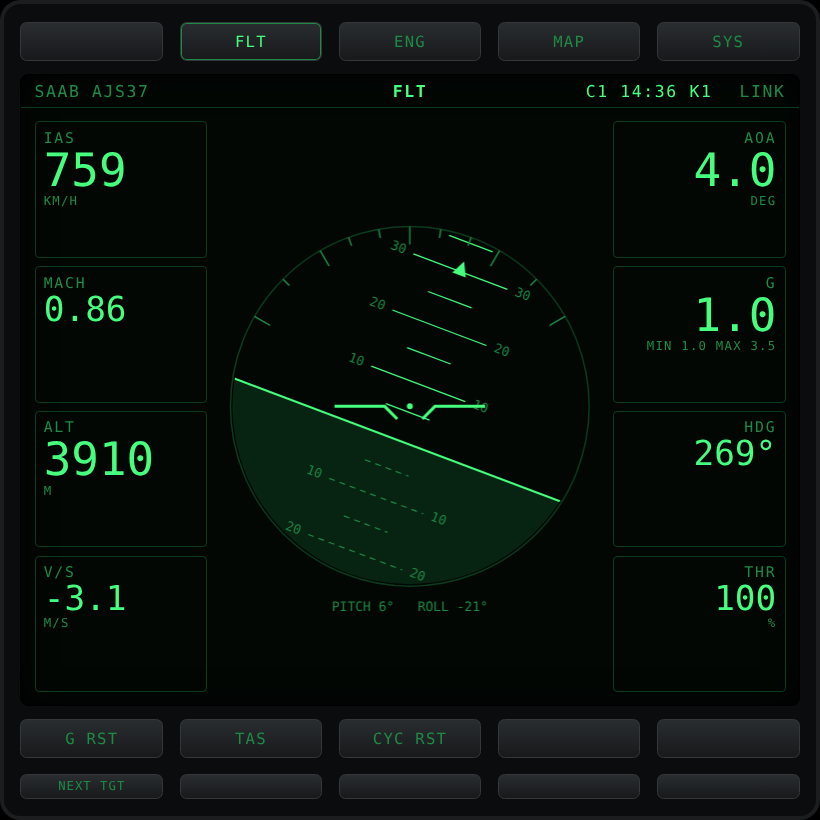
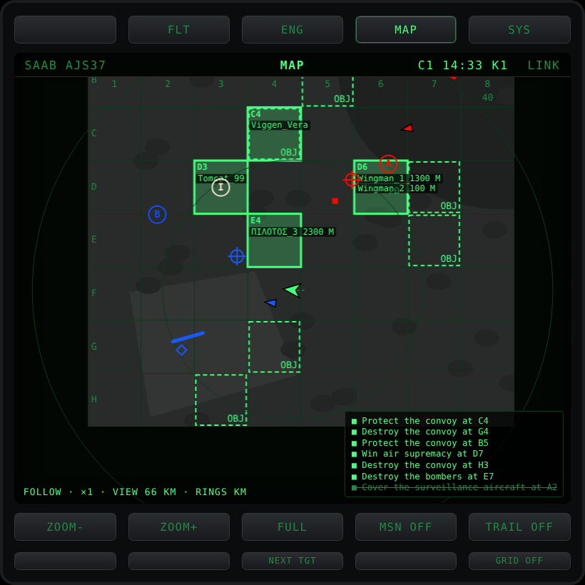

# WT-MFD

A second-screen MFD (multi-function display) for War Thunder, driven by an Elgato Stream Deck.

WT-MFD reads the flight data War Thunder already publishes on your own PC for its built-in browser map (`http://localhost:8111`) and draws it as a cockpit-style display on a second screen, a tablet or a Stream Deck. It was built for a home simulator cockpit: the numbers you need sit next to the game instead of on top of it.

> **Preview release.** This is an early version made by one person for his own sim pit. Expect rough edges and report what you find.

> **Not affiliated with Gaijin Entertainment. Use at your own risk.** Read the [disclaimer](#disclaimer) before you use it.

| Flight page | Map page |
|---|---|
|  |  |

*Screenshots use the bundled test server (`source/test/mockwt.py`), not a real match.*

## Contents

- [Disclaimer](#disclaimer)
- [What it shows](#what-it-shows)
- [Install](#install)
- [Using it](#using-it)
- [Stream Deck](#stream-deck)
- [Settings](#settings)
- [Match logs](#match-logs)
- [Troubleshooting](#troubleshooting)
- [Building from source](#building-from-source)
- [Contributing](#contributing)
- [License](#license)

## Disclaimer

**WT-MFD is an unofficial, fan-made tool.** It is not made, endorsed, approved or supported by Gaijin Entertainment. War Thunder and related names are trademarks of Gaijin Entertainment.

**What it does and doesn't do.** WT-MFD only reads the data War Thunder itself publishes on `localhost:8111` for its own browser map and instruments. It does not modify game files, inject code into the game, read game memory, send any input to the game, or automate anything. If the game doesn't show something on its own map, WT-MFD doesn't either.

**You use it at your own risk.** Gaijin has not approved this tool and can change its rules at any time. Gaijin may consider third-party software that reads game data and turns it into extra information (such as range, bearing, timers or the aiming estimate on the FLT page) to give an unfair advantage, and may restrict or ban accounts that use it. A Gaijin community manager has said on the official forum that using localhost data for overlays is generally not a bannable offense, but that is not a guarantee and it is not a statement about this tool. Read the current [Terms of Service](https://legal.gaijin.net/termsofservice) and decide for yourself. The author accepts no responsibility for any consequence of using WT-MFD, including account restrictions or bans. The software is provided "as is", without warranty of any kind (see [LICENSE](LICENSE)).

**Why it exists.** WT-MFD was not made to gain an advantage in the game. It started as a personal challenge: to make use of the game's own data in a simulator cockpit, so flight information is readily available on a second screen and Stream Deck instead of being overlaid on the game. Please use it in that spirit.

## What it shows

Four pages, switched with the buttons above the screen (or the top row of the Stream Deck):

| Page | What it shows |
|---|---|
| **FLT** | IAS or TAS, Mach, altitude, climb rate, angle of attack, G with session min/max, heading, throttle, attitude indicator |
| **ENG** | Fuel (kg and %), burn rate, endurance, bingo marker and time to bingo, per-engine throttle, RPM, thrust, temperatures |
| **MAP** | The game's own map with grid (numbered columns, lettered rows), you, your trail, range rings, and every object the game puts on its map. With **MSN** on, your team's objectives are listed in the corner and their grid squares are outlined |
| **SYS** | Gear, flaps and air brake lamps, mission objectives, kill and damage feed, chat |

On every page, the header shows your aircraft, the page, the Air Simulator [reward cycle timer](#reward-cycle-timer-air-simulator) and the link status.

## Install

### Requirements

- Windows 10 or 11 (64-bit)
- War Thunder
- **WebView2 runtime**: built into Windows 11 and up-to-date Windows 10. The installer tells you if it's missing: `winget install Microsoft.EdgeWebView2Runtime`
- Optional: an Elgato Stream Deck (the 15-key layout is what the plugin is made for)

Releases are self-contained: you don't need to install .NET.

### Installer (recommended)

1. Download **`WT-MFD-Setup-v<version>-win-x64.exe`** from the [Releases](../../releases) page.
2. Run it. It installs for your Windows user only (no admin rights) into `%LOCALAPPDATA%\Programs\WT-MFD`, adds WT-MFD to the Start menu, and can install the Stream Deck plugin for you.
3. Start **WT-MFD**, then War Thunder. The MFD goes from **NO LINK** to **HANGAR**, then comes alive when you're in an aircraft.
4. Optional: open **WT-MFD settings** from the Start menu and set `Callsign` to your in-game name (see [Settings](#settings)).

Installing a newer version over an old one keeps your settings. Uninstall from Windows Settings, Apps; that also removes the match logs and the Stream Deck plugin.

**"Windows protected your PC"?** The installer isn't code-signed yet, so Windows SmartScreen may warn about it. Click **More info**, then **Run anyway**. Each release lists SHA256 checksums in `SHA256SUMS.txt`, and every release is built from this repository's source by [GitHub Actions](.github/workflows/release.yml), so you can see exactly what went into it.

### Portable zip

Prefer no installer? Download **`WT-MFD-v<version>-portable-win-x64.zip`**, unzip it to a folder you can write to (for example `Documents\WT-MFD`, not Program Files), and double-click **`Start MFD.cmd`**. Settings are in `app\settings.json`; the Stream Deck plugin installs with `streamdeck\Install Stream Deck plugin.cmd`.

### From source

See [Building from source](#building-from-source). `Build exe.cmd` builds the app and puts a **WT-MFD** shortcut on your desktop and in the Start menu.

## Using it

### The window

WT-MFD opens as its own app window, without a browser and without a title bar:

| To | Do |
|---|---|
| Move the window | Drag the bezel or the slim strip at the top |
| Resize it | Drag any edge |
| Fill the screen it is on | Double-click the bezel, press **F11**, or the **□** button top right (again to go back) |
| Minimise / close | **–** and **✕** top right (or Alt+F4) |

The first time, it opens filling your second screen (or in the middle of your only screen). After that it reopens where you left it; the spot is saved in `app\window.json`. Only one WT-MFD runs at a time: starting it again brings the open one forward.

The MFD is also a web page: `http://localhost:8120` works in any browser, on a tablet (with `"Lan": true`), and for the Stream Deck. To run WT-MFD with a console window and no app window, set `"Window": false` in `settings.json`.

**Without a Stream Deck:** click the bezel buttons, or use the keyboard when the MFD window has focus: `1` to `4` for the pages, `Q W E R T` for row 2, `A S D F G` for row 3.

### Map

**Mouse:** scroll to zoom in and out around the cursor (same steps as ZOOM+/ZOOM−), hold the middle button and drag to pan. A middle click, or FOLLOW / FULL, puts the view back. The pan is per screen; zoom is shared with the Stream Deck.

**Waypoints:** click the map to drop a waypoint; click on a target, zone or ship and it snaps exactly onto it. Add up to 9 for a route. The box bottom left shows the active waypoint's grid square, distance, bearing and time to get there at your current speed, plus the whole route. Click a waypoint to remove it, right-click the map to remove all. Waypoints are cleared when a new map loads.

**Next target:** selects one enemy object the game shows on its map (ground units, bombing points, ships, airfields), the nearest first; each press moves on to the next nearest. Its distance, bearing and ETA appear on the map and on the FLT page. If the target moves (ships, convoys) the marker follows it.

**Manual target:** Ctrl+click the map to put the target there yourself. Ctrl+click on a map object and the target locks onto that object and follows it. CLR TGT removes it.

### Rocket hold-over estimate (FLT page)

For aircraft without a rocket aiming computer. War Thunder doesn't report which weapon is selected, so WT-MFD picks a weapon profile by aircraft (for example Mi-28: S-8KO) and the FLT third-row button cycles profiles or switches it off. With a target or waypoint selected, the FLT page shows `S-8KO · HOLD +3.4° · PITCH +1.0° ▼ · 6.6 S`: how far above the target to aim, the pitch to hold (▲ raise the nose, ▼ lower it, ● on it) and the flight time. Amber brackets on the attitude indicator mark that pitch. It's simple ballistics (average speed and gravity, height from the radar altimeter), so tune `AvgSpeed` and `PitchOffset` in `settings.json` after a test flight. Beyond `MaxRange` it says OUT OF RANGE.

### Team calls

When a teammate uses quick chat or types in team chat, the call pops up as a banner on every page for 8 seconds. Quick-chat calls like "Follow me!" carry the sender's grid square and altitude; that square blinks on the map for 45 seconds with the caller's name and altitude (for example `D6 · Wingman_1 1300 M`). A grid square typed in chat ("bandit north of C4") is marked the same way. Set `Callsign` in `settings.json` so your own calls don't pop up.

### Reward cycle timer (Air Simulator)

Air Simulator battles (Enduring Confrontation) pay out in 15-minute cycles of life that start when you spawn. The header shows the current cycle, for example `C2 11:42 K1`: second cycle since you spawned, 11:42 until it pays out, one kill in it. It turns amber in the last minute.

| Shows | Means |
|---|---|
| `C1 14:59` | Cycle running, counting down to the payout |
| **LAND** (amber) | A cycle has paid out: landing now collects the last part of the reward. Blinks for the first 20 seconds |
| **BONUS** | You landed after a payout (shown for 20 seconds) |
| **DOWN** (red) | Shot down, waiting for your next spawn |
| **READY** | Spawned, waiting for the engine to start |

It runs by itself. Deaths come from the kill feed, so set `Callsign` to your in-game name. A spawn is when the game swaps the vehicle and the engine then starts from cold. Landing to rearm does not restart it, and neither does browsing aircraft on the respawn screen. If it gets it wrong (or WT-MFD was started mid-flight), restart it by hand: **CYC RST** on the FLT page (bottom row, button 3), click the timer in the header, or a Stream Deck key with the `cycle/reset` command.

The reward rules come from community measurements, not from Gaijin, and can change. `CycleMinutes` in `settings.json` changes the cycle length.

## Stream Deck

### Plugin: live key labels (recommended)

The WT-MFD Stream Deck plugin draws each key's label live, straight from the MFD. The middle row relabels itself when you change page, and the current page is highlighted.

1. The installer does this for you (tick "Install the WT-MFD Stream Deck plugin"). Without the installer, double-click **`streamdeck\Install Stream Deck plugin.cmd`**. It closes Stream Deck, installs the plugin and starts Stream Deck again.
2. In Stream Deck, find **WT-MFD** in the action list on the right.
3. Drag **MFD Button** onto all 15 keys (14 inside a Stream Deck folder, where the top-left key is the back key). Each key sets itself up from its position:
   - row 1: pages on keys 2 to 5 (key 1 stays free for the folder back key)
   - row 2: page buttons
   - row 3: more page buttons

While WT-MFD isn't running, the keys show **MFD OFF**. To give a key a different job, select it and pick another button in its settings.

**Reward cycle key:** give a key the job "Air Sim reward cycle: live countdown, press = restart". It shows the countdown, **LAND** in amber when landing pays the bonus, and **DOWN** after a death. Pressing it restarts the cycle.

`streamdeck\icons\` holds two extra key icons (back and enter) for Stream Deck folders.

### Without the plugin (API Ninja, text labels only)

1. Install **API Ninja** (by BarRaider) from the Elgato Marketplace.
2. For each key, add an API Ninja action with request type `GET`, the URL from the table below, and response type **Response is text**. The app answers a key press with that button's current label (`MAP`, `ZOOM+`, `FOLLOW`...).

Each URL is `http://localhost:8120/api/cmd/` followed by the code, for example `http://localhost:8120/api/cmd/osb/t2`.

| | Key 1 | Key 2 | Key 3 | Key 4 | Key 5 |
|---|---|---|---|---|---|
| **Row 1 (pages)** | free: folder back key | `osb/t2` FLT | `osb/t3` ENG | `osb/t4` MAP | `osb/t5` SYS |
| **Row 2 (page buttons)** | `osb/b1` | `osb/b2` | `osb/b3` | `osb/b4` | `osb/b5` |
| **Row 3 (more page buttons)** | `osb/g1` | `osb/g2` | `osb/g3` | `osb/g4` | `osb/g5` |

### What the buttons do

Rows 2 and 3 change with the page, like a real MFD. The MFD always prints what each button does right now.

**Row 2:**

| Page | b1 | b2 | b3 | b4 | b5 |
|---|---|---|---|---|---|
| FLT | G reset | IAS / TAS | Restart the reward cycle (CYC RST) | | |
| ENG | Bingo −100 kg | Bingo +100 kg | Reset burn rate | | |
| MAP | Zoom out | Zoom in | Follow me / whole map | Mission objectives on/off | Trail on/off |
| SYS | Event filter (all / damage / chat) | Clear log | | | |

**Row 3:**

| Page | g1 | g2 | g3 | g4 | g5 |
|---|---|---|---|---|---|
| FLT | Next target | Clear target | Weapon profile (hold-over) | | |
| ENG | Bingo −500 kg | Bingo +500 kg | Bingo = 25% of full fuel | | |
| MAP | Clear waypoints | Remove active waypoint | Next target | Clear target | Grid on/off |
| SYS | Night | Dim | Bright | Colour | Metric / imperial |

Fixed commands also exist if you'd rather give a key one job, for example `page/map`, `map/zoomin`, `fuel/bingo-up`, `display/night` or `cycle/reset`. For the full list, open `http://localhost:8120/api/commands` while the app runs.

## Settings

`settings.json` next to `WT-MFD.exe` (Start menu: **WT-MFD settings**). Restart WT-MFD after changing it.

| Setting | Default | What it does |
|---|---|---|
| `Port` | 8120 | Port for the MFD page and Stream Deck URLs |
| `WarThunderUrl` | `http://localhost:8111` | Where War Thunder publishes its data |
| `Lan` | `false` | `true` lets a tablet on your home network open `http://<this-pc>:8120` |
| `Callsign` | empty | Your in-game name. Event lines mentioning you turn amber; needed for the reward cycle to see your deaths |
| `DefaultBingoKg` | 1000 | Starting bingo fuel |
| `InvertAdiPitch` / `InvertAdiRoll` | `false` | Flip these if the attitude indicator moves the wrong way |
| `Log` | `true` | Record what the game sends, one file per match (see [Match logs](#match-logs)) |
| `Window` | `true` | Open the MFD in its own app window. `false` = console window, open the MFD in a browser yourself |
| `CycleMinutes` | 15 | Length of the Air Simulator reward cycle |
| `Weapons` | Mi-28 S-8KO | Weapon profiles for the hold-over estimate |

## Match logs

While WT-MFD runs, it records what War Thunder sends into the `logs` folder next to `WT-MFD.exe`, one file per match, named by date, time and aircraft: chat, the kill feed, mission objectives, the map every 30 seconds, flight data every 10 seconds, reward cycle events and errors. They are for finding bugs and building features from real matches. The newest 200 files are kept and a single file stops at 50 MB. Set `"Log": false` to turn it off.

**Privacy:** match logs contain other players' names and chat messages. Don't publish them, and remove names before attaching a log to a bug report.

## Troubleshooting

- **NO LINK while flying:** War Thunder must be running. Check that `http://localhost:8111` opens the game's web map in a browser.
- **APP LINK LOST:** the page can't reach WT-MFD itself. Is `WT-MFD.exe` running?
- **WT-MFD can't save its settings or logs:** it was put in a folder Windows protects (like Program Files). Use the installer, or unzip the portable version into your Documents.
- **The window doesn't open:** install the WebView2 runtime (see [Requirements](#requirements)).
- **The attitude indicator rolls the wrong way:** set `InvertAdiRoll` to `true` and restart the app.
- **Nothing on some pages for some aircraft:** War Thunder reports different values per aircraft. Fields it doesn't send show `---` or `N/A`.
- **The reward cycle timer missed a spawn or death:** check that `Callsign` is set, and use CYC RST. The match log has a `cycle` line for every start, death, payout and landing.

## Building from source

Needs the **.NET 8 SDK** (`winget install Microsoft.DotNet.SDK.8`) and, to change the front end, **TypeScript** (`npm install -g typescript`).

- **Build and install:** close WT-MFD if it's running, then double-click **`Build exe.cmd`**. It builds into `app\` (keeping your `settings.json`) and puts **WT-MFD** on your desktop and in the Start menu.
- **Package a release:** `"Package release.cmd" 0.1.0-preview` builds the portable zip and, with [Inno Setup 6](https://jrsoftware.org/isinfo.php) installed, the installer into `dist\`. Real releases are built by GitHub Actions when a `v*` tag is pushed (see [`.github/workflows/release.yml`](.github/workflows/release.yml)).
- **Edit the front end:** change `source\ts\app.ts`, then run `tsc -p source\ts`. It compiles into `source\src\web\app.js`, which is embedded in the program, so rebuild afterwards. The compiled `app.js` is committed so the app builds without TypeScript.

### Project layout

| Path | What it is |
|---|---|
| `source\src\` | The app: an ASP.NET Core minimal API in C# (`Program.cs`, `Telemetry.cs`, `Commands.cs`...) |
| `source\src\MfdWindow.cs` | The app window: a plain Win32 window hosting WebView2 (no WinForms or WPF) |
| `source\src\RewardCycle.cs` | The Air Simulator reward cycle logic |
| `source\src\web\` | The MFD page (HTML, CSS and the compiled JavaScript), embedded in the program |
| `source\ts\app.ts` | The front end source |
| `source\test\mockwt.py` | A fake War Thunder server for testing without the game |
| `source\test\sdharness.py` | Pretends to be the Stream Deck app and saves the key faces as images |
| `streamdeck\` | The Stream Deck plugin and its installer |
| `installer\` | The Windows installer (Inno Setup script) and the disclaimer it shows |
| `.github\workflows\release.yml` | Builds, tests and publishes releases |

### Testing without the game

`source\test\mockwt.py` serves fake flight data, map, chat and kill feed: `python source\test\mockwt.py 8111` (needs Pillow: `pip install pillow`). Then start WT-MFD as normal.

For the reward cycle: `http://localhost:8111/mode?v=hangar`, then `mode?v=flying&ias=0&rpm=0` (spawned, engine off), `mode?rpm=5000` (engine start), `mode?ias=&rpm=` (flying again), and `feed?msg=X (MiG-21) shot down <Callsign> (AJS37)` for a death.

## Contributing

Bug reports and pull requests are welcome. Please:

- describe what you expected and what happened, with the aircraft and game mode
- strip other players' names from any match log you attach
- keep to the fair-play rule: WT-MFD only shows what the game already publishes for its own map and instruments. Features that reveal information the game hides (for example enemy positions it doesn't put on its map) won't be accepted.

## License

[MIT](LICENSE). Not affiliated with Gaijin Entertainment; see the [disclaimer](#disclaimer).
